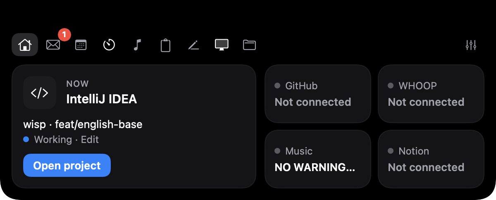
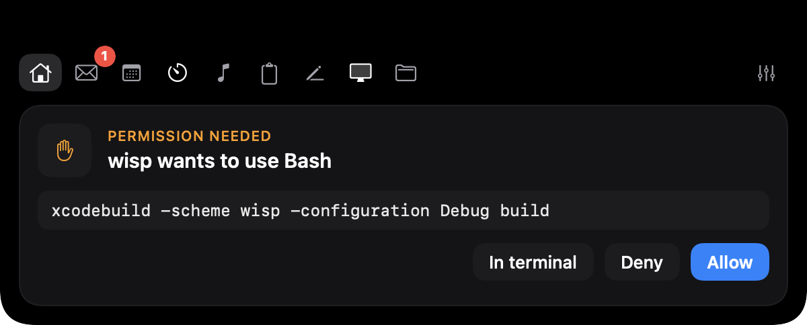
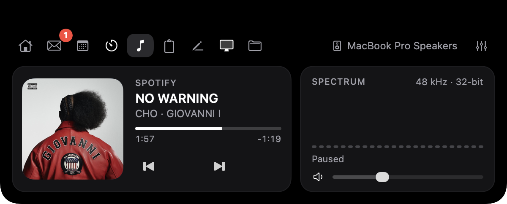
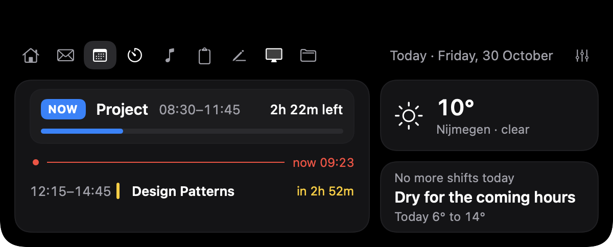

<div align="center">


# wisp

**A small light at the top of your screen.**

wisp lives in your MacBook's notch and keeps your day within reach: your Claude Code sessions, your mail, your music, your agenda and the weather, and soon a focus timer, clipboard, notes and system stats. One click away, and out of sight the rest of the time.




</div>

---

## Why

The notch is the one bit of screen you never use. wisp turns it into a quiet dashboard: pure black like the hardware around it, no mascot, no emoji, no gradients. It stays the size of the notch until you need it, opens into a 600-point panel when you click, and folds back the moment you move on.

## Features

- **Claude Code, live**: every session in IntelliJ, Rider, VS Code or a terminal shows up under *In progress* with its project, branch and what it is doing right now. *Open project* takes you straight back to the right IDE window.
- **Approve from the notch**: when Claude Code asks for permission, the notch opens with the command and three buttons: *Allow*, *Deny*, *In terminal*. wisp never approves anything on its own; no click within 110 s means Claude asks in the terminal as usual.
- **Mail**: your Gmail inbox, read-only, with an *All / Unread* filter and an unread badge on the tab. New mail arrives by push (IMAP IDLE), not by polling. wisp never marks anything as read.
- **Music**: whatever your Mac is playing (Spotify, Music, YouTube in the browser), with artwork, progress and glass controls. Next to it, a **live spectrum** of what you hear: 24 bands from bass to treble, the bass/mid/treble mix and the loudness. While music plays, the closed notch grows a little wing on each side: artwork on the left, a mini spectrum on the right.
- **Calendar & weather**: today's timeline from the macOS Calendar app (and so from Google Calendar too), with what's done struck through, what's on now in its own card with a bar that fills up, a red *now* line and a countdown to what's next; in the evening it already shows how tomorrow starts. Next to it the weather where you are and, on a work day, when to leave for your shift and whether it stays dry.
- **English and Dutch**: wisp follows your Mac's language, or pick one in Settings.
- **Calm by default**: the closed notch draws nothing extra and uses 0 % CPU. No timers run while it is closed.
- **Any Mac**: on a screen without a notch, wisp sits in a small bar at the top centre.
- **Private by design**: no telemetry, no account. Passwords live in your macOS Keychain. wisp only talks to the services you connect.

<table>
<tr>
<td></td>
<td></td>
</tr>
<tr>
<td align="center"><sub>Home: the current Claude Code session</sub></td>
<td align="center"><sub>Approving a command without leaving what you're doing</sub></td>
</tr>
<tr>
<td colspan="2"></td>
</tr>
<tr>
<td colspan="2" align="center"><sub>Music: what's playing, and a live spectrum of what you hear</sub></td>
</tr>
<tr>
<td colspan="2"></td>
</tr>
<tr>
<td colspan="2" align="center"><sub>Agenda: today's timeline, the weather, and when to leave for your shift</sub></td>
</tr>
</table>

### On the way

A focus timer that knows what you are working on, clipboard history, quick notes, system stats, a restyled file drop, mail notifications in the notch, and GitHub, WHOOP and Notion on the Home tab. The designs for all of them are in [`design/boards/`](design/boards).

## Install

### Download

Signed and notarized builds go on the [Releases](https://github.com/ahmad-sy1/wisp/releases) page (the first one is still to come). Unzip, move **wisp.app** to `/Applications` and open it.

### Build from source

You need Xcode and [XcodeGen](https://github.com/yonaskolb/XcodeGen).

```bash
brew install xcodegen
git clone git@github.com:ahmad-sy1/wisp.git
cd wisp
./scripts/install.sh
```

`install.sh` builds a Release version, replaces `/Applications/wisp.app` and starts it. Local builds are signed with a Developer ID, so change `DEVELOPMENT_TEAM` in `project.yml` if you build with your own account.

## Setup

Open **Settings**: click the notch, then the sliders icon on the right. On a full menu bar the wisp icon can hide behind the notch; opening wisp again from Spotlight also brings up Settings.

| What | Why | How |
|---|---|---|
| **Claude Code hooks** | live sessions and approvals | *Claude Code → Installeren…* shows exactly which lines it adds to `~/.claude/settings.json`. Nothing is written until you click *Installeren*, and a dated backup is made first. Restart running Claude Code sessions afterwards. |
| **Gmail** | the Mail tab and unread badge | Your address and a Google [app password](https://myaccount.google.com/apppasswords). Both are stored in the Keychain only. |
| **Agenda & weer** | the Agenda tab | Calendar access (macOS asks once), which calendars count, how a shift is recognised (the word *dienst* or a calendar), your ride to work in minutes, and the place for the weather (Nijmegen by default). |
| **Accent colour** | buttons, unread dots, highlights | Blue, green, orange or purple. |
| **Open at login** | wisp is always there | One toggle. |

Music needs no setup. The live spectrum asks once for macOS's *System Audio Recording* permission; *Settings → Muziek* turns it on or off.

## Things to try

| Do this | wisp does that |
|---|---|
| Hover the notch | it swells a little |
| Click it | the panel opens on the last tab you used |
| Move the mouse away | it folds back after the delay you set |
| Let Claude Code run a command that needs permission | the notch opens with *Toestaan / Weigeren / In terminal* |
| Click a mail | it opens in Gmail and stays unread in your inbox |
| Press play in Spotify | the closed notch gets artwork and a mini spectrum |
| Open the Music tab during a song | the spectrum moves with what you hear, from bass to treble |
| Open the Agenda tab | today at a glance, the weather, and when to leave for your shift |
| Click the artwork in the Music tab | the app that is playing comes to the front |

## How it works

- **Notch**: a borderless, non-activating `NSPanel` that is always exactly as big as what it draws, so nothing around the notch is ever blocked and no polling is needed. Hover comes from a tracking area, clicks from SwiftUI.
- **Claude Code**: a small compiled helper, `wisp-hook`, ships inside the app. Claude Code runs it for each hook event; it forwards a trimmed copy over a Unix socket. If wisp isn't running, it exits in about 30 ms, so Claude Code never waits.
- **Mail**: a minimal IMAP client on `Network.framework` (LOGIN, EXAMINE, SEARCH, FETCH with `BODY.PEEK`, IDLE).
- **Music**: MediaRemote only answers Apple-signed processes since macOS 15.4, so the system `perl` loads a tiny bundled dylib that streams "now playing" changes as JSON lines. The spectrum comes from a Core Audio process tap and an FFT (Accelerate), and only runs while it is on screen.
- **Agenda & weather**: EventKit reads today's events, only while the tab is open. The weather comes from [Open-Meteo](https://open-meteo.com) (no key, no account) at most every 15 minutes, and only when you open the tab.
- **No dependencies**: native Swift 6, SwiftUI and AppKit.

The details are in [`docs/ARCHITECTURE.md`](docs/ARCHITECTURE.md) and [`docs/INTEGRATIONS.md`](docs/INTEGRATIONS.md).

## Documentation

| Document | What's in it |
|---|---|
| [ARCHITECTURE.md](docs/ARCHITECTURE.md) | how the app is put together, file by file |
| [INTEGRATIONS.md](docs/INTEGRATIONS.md) | Claude Code hooks, Gmail, Now Playing, and the plan for the next integrations |
| [DESIGN.md](docs/DESIGN.md) | colours, sizes, typography and the rules every screen follows |
| [RELEASING.md](docs/RELEASING.md) | signing, notarization and publishing a release |
| [CONTRIBUTING.md](CONTRIBUTING.md) | how to build, branch and open a pull request |
| [SPEC.md](docs/SPEC.md) | what every tab should do (in Dutch) |
| [ROADMAP.md](docs/ROADMAP.md) | what's planned next, and what was decided against |
| [CHANGELOG.md](CHANGELOG.md) | what changed |

## Privacy

wisp has no servers and no analytics. It connects to Gmail only after you add an account, and reads Now Playing, your calendar and your Claude Code sessions locally on your Mac. Your calendar is only read and never leaves the Mac; for the weather, only the coordinates of the place you chose go to Open-Meteo. The live spectrum analyses the sound on your Mac and never records, stores or sends it. Tool output and file contents from Claude Code never reach the app: `wisp-hook` strips them before forwarding. Passwords are stored in the macOS Keychain and nowhere else.

## Credits

Designed and built by Ahmad Alasmi.

## License

Copyright © 2026 Ahmad Alasmi. All rights reserved. See [LICENSE](LICENSE).
